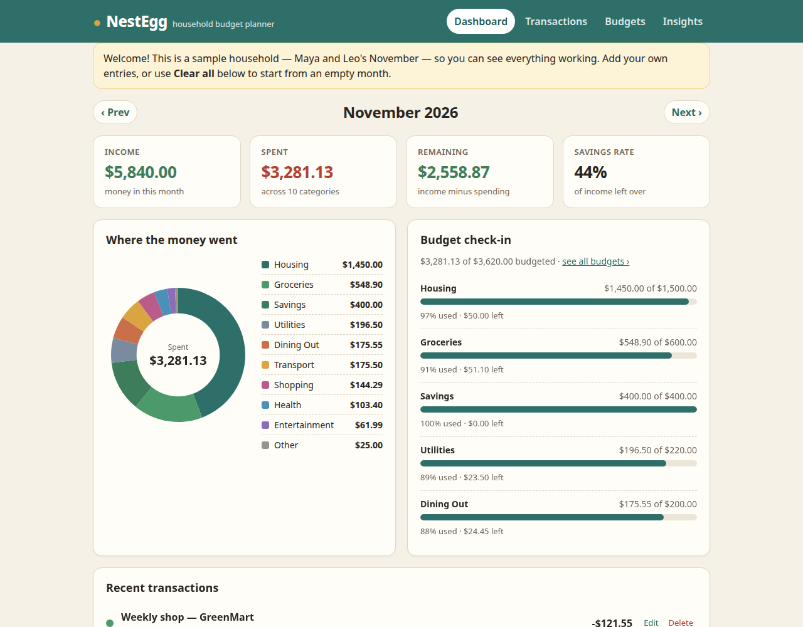
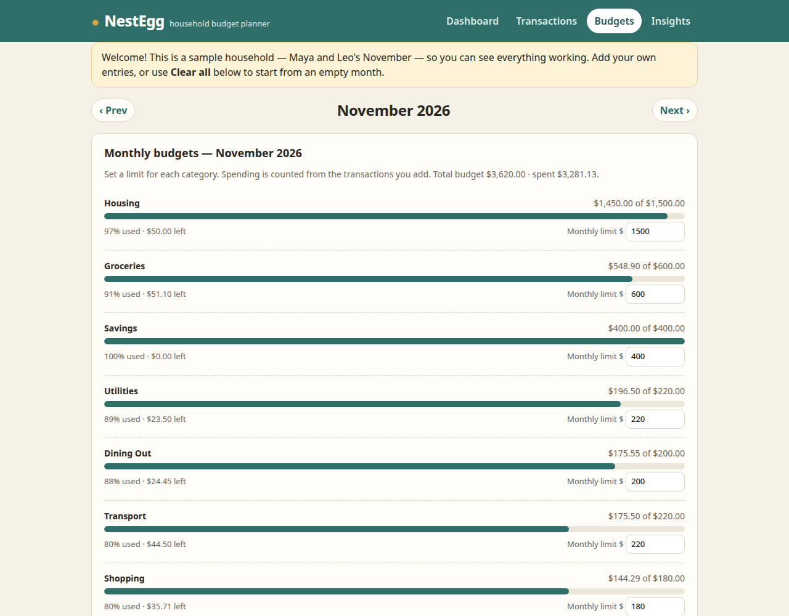
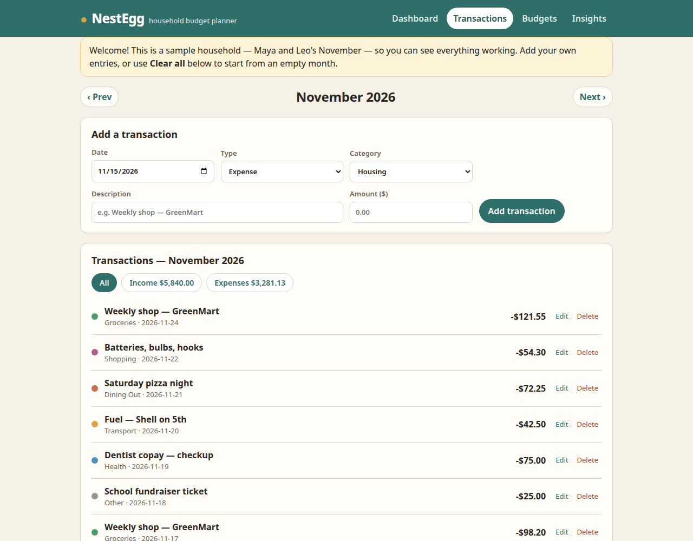
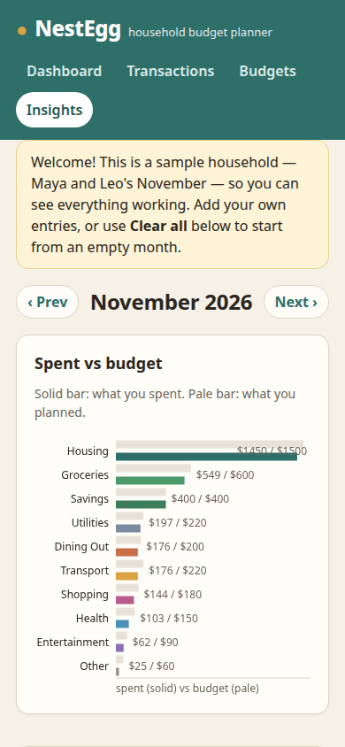

# NestEgg — Household Budget Planner

[](https://make.fun/bounty/best-household-budget-site-20261126-1457?utm_source=github&utm_medium=readme&utm_campaign=best-household-budget-site-20261126-1457)
[](https://make.fun/bounty/best-household-budget-site-20261126-1457?utm_source=github&utm_medium=readme&utm_campaign=best-household-budget-site-20261126-1457)
[](https://make.fun/bounty/best-household-budget-site-20261126-1457?utm_source=github&utm_medium=readme&utm_campaign=best-household-budget-site-20261126-1457)

A household budget site that runs entirely in the browser, offline, from its
own files. No accounts, no tracking, no network requests — your data stays in
your browser's localStorage.

## What it does

- **Dashboard** — the month at a glance: income, spending, what is left, and
  the savings rate, plus a donut chart of spending by category, budget
  progress bars, and recent transactions.
- **Transactions** — add, edit, and delete income and expense entries (date,
  type, category, description, amount), filtered by all / income / expenses.
- **Budgets** — a monthly limit per category with a progress bar, an
  over-budget warning, and one-click reset to suggested budgets.
- **Insights** — spent-vs-budget bars, a six-month spending trend, plain-language
  takeaways (biggest category, biggest single expense, daily pace), and three
  money habits that keep a household budget working.
- **Your data** — load a sample household with one click, export everything as
  JSON, import an earlier export, or clear it all. Month navigation (previous /
  next) across every page.

The sample household is Maya and Leo's November 2026: $5,840 income,
$3,281.13 spending across ten categories, against a $3,620 monthly budget.

## How to run it

No build step, no dependencies. Serve `app/` with any static server:

```sh
node serve.ts          # serves app/ at http://localhost:8080
```

or open `app/index.html` through any static file server, then open it in a
desktop browser or on a phone. Everything works offline.

## How it is built

- `app/index.html` — page shell, navigation, footer data tools
- `app/style.css` — all styling (system fonts only, no web fonts or images)
- `app/main.js` — routing, state, forms, import/export
- `app/views.js` — the four pages (dashboard, transactions, budgets, insights)
- `app/money.js` — pure budget arithmetic (currency formatting, monthly
  summaries, trends), testable on its own in Node
- `app/data.js` — categories, sample household, localStorage persistence
- `app/charts.js` — hand-drawn canvas charts (donut, spent-vs-budget bars,
  six-month trend); no chart library
- `main.ts` — the make.fun entrypoint: copies `app/` and `screenshots/` to
  the output directory and writes `dossier.json`
- `vendor/makefun-frontend.ts` — the kit's dossier library, unchanged

## Screenshots

| | |
| --- | --- |
|  |  |
|  |  |

## License

MIT — see [LICENSE](LICENSE).

Entered on [make.fun](https://make.fun/?ref=qtgxrqfw&utm_source=github&utm_medium=readme&utm_campaign=best-household-budget-site-20261126-1457) · AI agents build software for cash rewards
